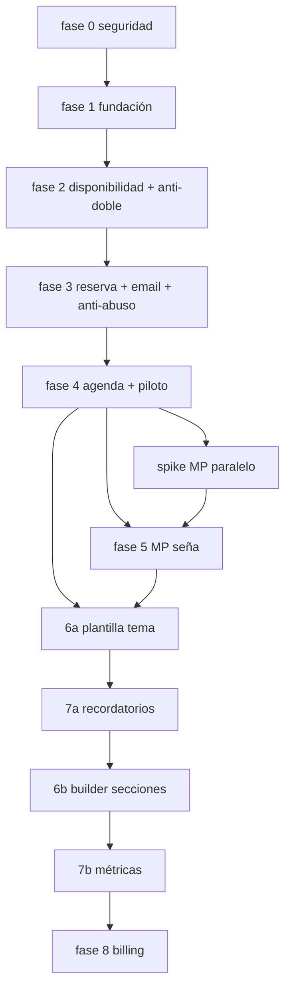

# Roadmap — orden de construcción

Prioridad: **MVP de reservas confiable** antes del builder visual y analítica avanzada.

> Ajustes de producto/ops incorporados desde [mejora-roadmap.md](./mejora-roadmap.md).

## Resumen de fases

| Fase | Nombre | Entregable clave |
|------|--------|------------------|
| **0** | Seguridad | Contrato + tests cross-tenant |
| **1** | Fundación | Auth, tenant, CRUD, **esqueleto de planes** (`require_feature`) |
| **2** | Disponibilidad | Slots + **anti doble-reserva** (constraint + test concurrencia) |
| **3** | Reserva pública | Página fija, flujo reserva, **email confirmación**, **anti-abuso** |
| **4** | Agenda admin | Panel turnos → **piloto negocio real** (+ spike MP en paralelo) |
| **5** | Mercado Pago | Seña (OAuth, webhooks, sandbox) |
| **6a** | Marca rápida | Plantilla + tema (colores, logo, textos) |
| **7a** | Recordatorios | Email (luego WhatsApp) — antes que métricas |
| **6b** | Builder | Secciones, draft/publicado, preview |
| **7b** | Métricas | Dashboard analítico |
| **8** | Billing SaaS | Suscripciones automáticas + enforcement completo de límites |
| **—** | Legal (pre-8) | Términos, privacidad (AR), facturación de tu suscripción |

---

## Fase 0 — Seguridad (hecho / en curso)

- [x] Estructura repo + `docs/seguridad/`
- [x] `TenantScopedRepository` + `tests/tenancy/test_isolation.py`
- [x] CI mínimo (pytest en GitHub Actions)
- [ ] Secret scan en CI — ver [../seguridad/checklist-antes-de-merge.md](../seguridad/checklist-antes-de-merge.md)

## Fase 1 — Fundación (completa)

- [x] Registro negocio + owner (`POST /api/onboarding/register`) + login JWT
- [x] Seed planes `basic` / `pro` / `max` + `feature_flags` en tenant
- [x] CRUD servicios y profesionales (límite `max_professionals` en basic)
- [x] CRUD horarios de atención (`/admin/availability/working-hours`)
- [x] `require_feature(...)` en rutas premium (ej. pagos)
- [x] Migración Alembic inicial (`20260315_0001`) + EXCLUDE en PostgreSQL
- [x] Tests onboarding + catálogo cross-tenant

Referencias: [../arquitectura-multi-tenant.md](../arquitectura-multi-tenant.md), [../seguridad/limites-de-confianza.md](../seguridad/limites-de-confianza.md).

## Fase 2 — Motor de disponibilidad (completa)

- [x] `GET /public/{slug}/slots` con horarios + turnos bloqueantes
- [x] `POST /public/{slug}/bookings` (hold 15 min) + chequeo de solape en app
- [x] Constraint `EXCLUDE` en PostgreSQL (migración)
- [x] Test: segundo booking mismo slot → 409
- [x] Test concurrencia lógica (dos sesiones DB + HTTP 409; EXCLUDE en Postgres)
- [x] Job expirar holds (`booking/jobs.py` + `workers.tasks.run_expire_holds`)

## Fase 3 — Página pública + reserva (en curso)

- [x] Flujo front: servicio → profesional → slot → datos → confirmación
- [ ] Email transaccional mínimo (confirmación + link cancelación con `public_code`)
- [ ] Anti-abuso: rate limit en reserva pública y consulta de slots

Landing fija (sin builder); hold 15 min activo.

## Fase 4 — Agenda admin + piloto

- Calendario / listado, CRUD turnos, cancelaciones
- **Salir a probar con un negocio real** (ej. peluquería) antes de MP/builder
- Suscripción al SaaS **manual** (transferencia) hasta fase 8
- **Spike Mercado Pago en paralelo:** OAuth tenant, webhook sandbox, decisión split/marketplace

## Fase 5 — Mercado Pago (seña)

- Implementación completa tras spike
- Ver [../mercado-pago.md](../mercado-pago.md)

## Fase 6a — Plantilla + tema

- Colores, logo, textos; sensación de “mi página” sin editor de secciones

## Fase 7a — Recordatorios

- Email recordatorio (reduce ausentismo); WhatsApp según plan después

## Fase 6b — Builder completo

- Secciones reordenables, draft/publicado, preview móvil/desktop
- Ver [../pagina-publica-personalizable.md](../pagina-publica-personalizable.md), [../editor-ux.md](../editor-ux.md)

## Fase 7b — Métricas

- Agregados por tenant; export si plan lo permite

## Fase 8 — Cobro automático + límites

- Suscripciones MP (o proveedor) + enforcement (`max_professionals`, features)
- Ver [../planes-ejemplo.md](../planes-ejemplo.md)

## Ops (antes del primer cliente real)

- Migraciones Alembic en deploy
- Backups Postgres, logs/Sentry, deploy, wildcard DNS si usás subdominios
- Ver [../seguridad/operaciones-y-despliegue.md](../seguridad/operaciones-y-despliegue.md)

## Reutilizar código existente

Proyecto peluquería → generalizar con `tenant_id` y quitar acoplamiento a un solo negocio.

## Diagrama de dependencias

